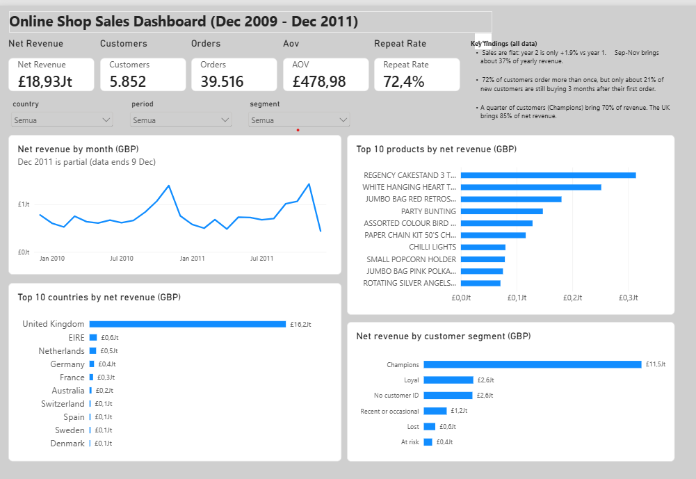

# E-commerce Sales Analysis: Why Did Sales Stop Growing?

A practice project done like a real freelance gig: a small online gift shop says its sales have been flat for a year and asks which products, customers and countries to focus on.

> **Note:** The client and the brief are fictional (see `brief/`). The data is the public *Online Retail II* dataset from the UCI Machine Learning Repository.



## The business problem

The shop owner and her business partner disagree. One wants to add more products, the other wants to push the best sellers. They asked four things:

1. Are sales really flat?
2. Which products make the money?
3. Do customers come back?
4. Which countries matter, and should the team look for new customers or keep the current ones?

## Main findings

| Question | Answer |
|---|---|
| Are sales flat? | Yes. Net revenue grew only **1.9%** in year 2 (£9.16M to £9.33M). |
| Is there a season? | Yes. September to November brings about **36-37%** of the yearly revenue. |
| Which products? | Sales are spread over 4,894 products. The top 10 bring only 7.6% of net revenue, but the top 10% of products bring **62%**, and the bottom 20% bring **0.3%**. |
| Do customers return? | **72%** of customers order more than once, but only about **21%** of new customers are still buying 3 months after their first order. |
| Who are the best customers? | **Champions** are 25% of customers with an ID and bring 70% of their revenue (**61%** of total net revenue). Four customers alone bring about 9% of total net revenue. |
| Which countries? | The UK brings **85%** of net revenue. EIRE ranks next but comes from only 3 customers. |

Other numbers: net revenue £18.93M, 39,516 orders, 5,852 customers with an ID, average order value £478.98. Returns and cancellations are about 3.6% of gross sales.

### Recommendations for the client

1. **Look after the best customers first.** Contact the Champions and the 470 "At risk" customers personally (the list is in the Excel file).
2. **Plan the autumn early.** Prepare stock and promotions for September to November before the season starts.
3. **Clean up before adding more products.** Review the bottom 20% of products (about 980 items) for clearance or bundling, and push the products that already sell.

These are based on sales, not profit, because there is no cost data.

## Approach

1. **Understand the brief** and write down definitions and assumptions (`brief/`).
2. **Clean the data** with pandas. Every decision is logged with row counts (`reports/cleaning_log.csv`).
3. **Load to PostgreSQL** and answer the business questions with SQL (`sql/`).
4. **Analyse and visualise** trends, products, countries, customer segments (RFM) and retention (`notebooks/`).
5. **Build a dashboard** in Power BI with filters for period, country and customer segment (`dashboard/`).
6. **Cross-check** every key number between pandas, SQL and Power BI (`reports/validation_checks.md`).
7. **Hand over** an Excel file with the results (`reports/retail_analysis_results.xlsx`).

## Dashboard

One page with five KPIs (net revenue, orders, customers, average order value, repeat rate), a monthly trend, the top 10 products and countries, and net revenue by customer segment. Three filters: country, period and customer segment. The file is `dashboard/retail_dashboard.pbix` (Power BI Desktop).

## Data cleaning decisions

| Step | Rows removed | Why |
|---|---|---|
| Exact duplicates | 34,335 | The same row twice would count a sale twice |
| Non-product codes (postage, fees, manual entries, gift vouchers) | 5,818 | They are not product sales |
| Price of 0 or less | 5,964 | Free items and accounting adjustments |
| Cancelled orders (invoice starts with C) | 17,914 moved to a separate returns table | Needed to calculate net revenue |
| Quantity of 0 or less in sales | 0 | Checked, none left |
| Missing Customer ID | 0 (226,761 rows kept) | Valid for product, country and time numbers. Left out of customer numbers |
| Product names | 0 | One name per product code (the most common one) |
| Large orders (outliers) | 0 | Reviewed. The two biggest ones (80,995 and 74,215 units) were cancelled and cancel out in net revenue |

The raw data is never changed. Raw rows: 1,067,371. Clean sales rows: 1,003,340.

Net revenue: gross sales £19,643,862 + returns -£716,426 = **£18,927,436**.

## Metric definitions

| Metric | Definition |
|---|---|
| Gross sales | Sum of quantity x unit price on normal orders |
| Returns | Same calculation on cancelled orders (negative numbers) |
| Net revenue | Gross sales + returns |
| Order | One invoice number |
| AOV (average order value) | Net revenue / number of orders |
| Repeat rate | Customers with 2 or more orders / all customers with a Customer ID |
| Year 1 / Year 2 | Dec 2009 - Nov 2010 / Dec 2010 - Nov 2011 (Dec 2011 is incomplete) |
| RFM | Score of 1-5 for how recently, how often and how much a customer buys |

Customer segments (simple rules chosen for this project): **Champions** = recent and frequent buyers (R and F of 4-5); **Loyal** = frequent but not recent; **At risk** = long ago but 3+ orders before; **Lost** = long ago and few orders; **Recent or occasional** = everyone else.

## How to run

You need Python (Anaconda is fine), PostgreSQL and, for the dashboard, Power BI Desktop.

1. **Set up Python**
   ```bash
   conda create -n retail python=3.11 -y
   conda activate retail
   pip install -r requirements.txt
   ```
2. **Get the data.** Follow `data/raw/README.md` and place `online_retail_II.xlsx` in `data/raw/`.
3. **Clean the data.** Run `notebooks/02_profiling_cleaning.ipynb`. It creates `data/processed/sales_clean.csv`, `data/processed/returns_clean.csv` and `reports/cleaning_log.csv`.
   *Note:* this notebook was first run in Google Colab, so its first cell uses Google Drive paths. To run it locally, change them to `data/raw/` and `data/processed/`.
4. **Load to PostgreSQL** (run from the project folder):
   ```bash
   psql -U postgres -c "CREATE DATABASE retail;"
   psql -U postgres -d retail -f sql/01_schema.sql
   psql -U postgres -d retail
   ```
   Then inside `psql`:
   ```sql
   \copy sales FROM 'data/processed/sales_clean.csv' CSV HEADER
   \copy returns FROM 'data/processed/returns_clean.csv' CSV HEADER
   ```
5. **Run the analysis queries:**
   ```bash
   psql -U postgres -d retail -f sql/02_analysis.sql
   ```
6. **Run the analysis notebook** `notebooks/03_analysis.ipynb`. It creates the charts in `reports/figures/` and the tables in `reports/tables/`.
7. **Open the dashboard** `dashboard/retail_dashboard.pbix` in Power BI Desktop. The data is stored inside the file.

Check: the notebook prints `1003340 17914 18,927,436` (sales rows, returns rows, net revenue), and the SQL results match the notebook.

*SQL note:* the queries use standard SQL and work in MySQL too, except `DATE_TRUNC` (use `DATE_FORMAT(invoice_date, '%Y-%m-01')`) and `CREATE TABLE returns (LIKE sales)` (use `CREATE TABLE returns LIKE sales`).

## Repository structure

```
ecommerce-sales-analysis/
├── brief/          client brief, scope and assumptions, proposal and Q&A
├── data/
│   ├── raw/        original data (not changed, how to download)
│   └── processed/  cleaned files (created by the notebooks)
├── sql/            schema and analysis queries
├── notebooks/      cleaning, analysis
├── dashboard/      Power BI file and screenshot
├── reports/        Excel file, charts, tables, cleaning log, validation checks
├── requirements.txt
├── .gitignore
└── README.md
```

## Limits of this analysis

- There is no cost data, so "makes money" means revenue, not profit.
- There is no marketing data, so we cannot say why sales moved in a given month.
- The data ends on 9 December 2011. December 2011 is left out of year comparisons.
- About 14% of net revenue has no Customer ID, so customer numbers cover about 86% of the business.
- The customer segments use simple rules chosen for this project, not a fixed standard.
- The December 2009 group in the retention chart includes customers who were already buying before the data starts.

## Tools

Python (pandas, matplotlib, seaborn) in Jupyter, PostgreSQL, Power BI Desktop, Excel (results file), Git and GitHub.

## Data source

Online Retail II, UCI Machine Learning Repository: https://archive.ics.uci.edu/dataset/502/online+retail+ii (see the page for the license terms).
